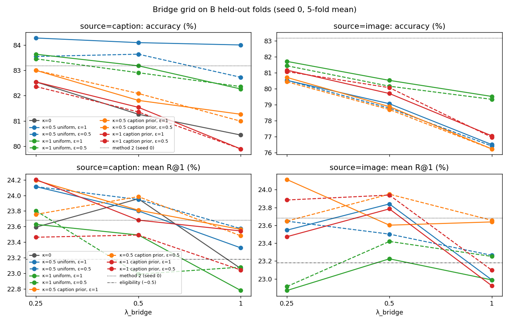

# Bridge results

Phase 4 (selection and comparison on B held-out folds) and phase 5 (one final evaluation on split C, §6) are
complete. The protocol is `docs/bridge_protocol.md`,
committed before any phase-4 run. B class labels are used for evaluation and selection on held-out folds only,
never for training (protocol §1). Every label-based selection is reported together with mean R@1 (mR1).

Regenerate (inside the container, from the repository root):

```
python scripts/pseudo_label_quality.py --a_logs 'runs/p4/grid_s0/caption_*_k0/*/fold*/train_log.json' --out runs/pl_quality
python scripts/bridge_results.py select1          # coarse ranking -> runs/p4/stage1.json
python scripts/bridge_results.py final --out runs/p4/results.md
python scripts/bridge_analysis.py --out runs/p4/analysis.md --plot docs/figs/bridge_sensitivity.png
```

Runs: `runs/p1/semi_s{0,1,2}` (method 2), `runs/p4/grid_s0/<cfg>` (seed-0 grid, 54 configs, job p4_grid
5132538, 31 min), `runs/p4/recheck/<cfg>_s{1,2}` and `runs/p4/soft/<cfg>_s{0,1,2}` (job p4_recheck 5133405, 14 min).
Common settings: ViT-B/32 laion2b, T = 500, τ_text = 0.01 (protocol §3), training template
"an aerial photo of {}.", evaluation template "A satellite image of {}.", hard targets unless stated.
Metrics are 5-fold means. Seeds 0–2 are given as mean ± std (population std over seeds).

## Summary

**C (final, §6):** ours vs method 2: acc 81.04 ± 0.20 vs 81.07 ± 0.14 (paired −0.03, p = 0.65, not
significant); per-class acc 82.54 vs 82.20 (+0.34 in all 5 seeds, p = 0.002); mean R@1 7.95 vs 7.82.
Test-time balancing † (transductive): 82.13 acc. The B summary follows.


| | acc | per-class acc | mR1 |
|---|---|---|---|
| #1 method 2 | 83.43 ± 0.23 | 84.57 ± 0.24 | 23.84 ± 0.12 |
| #3 balanced bridge (main; λ 0.25, ε_b 1, κ 0.5, uniform) | 83.88 ± 0.38 | 85.61 ± 0.39 | 24.09 ± 0.12 |
| #6 method 2 + test-time balancing † (transductive) | 85.80 ± 0.22 | 87.50 ± 0.20 | 23.84 ± 0.12 |

- **Main method.** It gains +0.45 acc, +1.0 per-class acc and +0.25 mR1 over method 2. The acc gain is
  about 1.2× the larger seed std. It was also selected as the best of 24 configs on the same folds, and its
  seed-0 lead (+1.10) shrank to +0.45 over 3 seeds. Treat it as a small, unconfirmed improvement on B.
- **Balancing is what helps.** The same bridge without balancing (#2, κ = 0) is 1.19 points *below*
  method 2. Balancing recovers that and adds a little. κ = 0.5 beats κ = 1, and the uniform prior beats the
  caption prior (grid marginals below).
- **source=image is clearly worse.** #4 is 2.3 points below method 2. The caption detour is better than the
  teacher's own image–class-name similarity.
- **Soft targets do not help.** #5 is 0.5 below #3.
- **Playfields gets worse.** It is the largest class in B (67 images), and the bridge drives its accuracy from
  15.9 % (method 2) to about 1 %. B-train captions give it almost no class mass (r share 0.01 %; zero hard
  pseudo-labels at κ = 0 on both held-out B and A). The balanced Sinkhorn on A does not fix this. The bridge
  also does not reduce the TV distance to the true B class distribution (12.4 vs 11.5).
- **Pseudo-label quality is below the student.** Every bridge pseudo-label setting is less accurate on held-out
  B (best 79.5 %) than method 2's own classifier (83.4 %). This bounds what the bridge can teach.
- **#6 is not comparable.** Test-time balancing of method 2's predictions (no training) gives +2.4 acc and
  +2.9 per-class acc, with retrieval unchanged. But it is transductive: it balances over the whole held-out
  set jointly.

## 1. Pseudo-label quality on held-out B (evaluation only; not used in any selection)

For each fold, the held-out B images are treated as unlabeled and go through the training pseudo-label
pipeline. The steps are:

1. teacher features;
2. top-3 captions from the fold's B-train bank;
3. compute r;
4. unbalanced Sinkhorn over the fold's about 219 held-out images (training uses 8,734 A images);
5. ŷ = argmax Q, compared with the B labels.

Generated by `scripts/pseudo_label_quality.py`.

### Pseudo-label quality on held-out B (evaluation-only use of B labels; ε_b = 1, τ_text = 0.01)

Pseudo-label accuracy / per-class mean accuracy (%) of ŷ = argmax Q against the B labels. EMA teacher = final teacher of method 2, mean ± std over seeds 0–2. 'accepted' = coverage-0.5 subset by max R.

| source | prior | κ | frozen CLIP: all | frozen CLIP: accepted | EMA teacher: all | EMA teacher: accepted |
|---|---|---|---|---|---|---|
| caption | (none) | 0 | 71.8 / 72.2 | 82.3 / 71.4 | 72.7 ± 0.2 / 73.2 ± 0.1 | 82.6 ± 0.1 / 71.2 ± 0.1 |
| caption | uniform | 0.5 | 76.1 / 77.1 | 85.1 / 78.5 | 77.0 ± 0.2 / 77.9 ± 0.2 | 86.2 ± 0.2 / 80.5 ± 0.1 |
| caption | uniform | 1 | 78.5 / 79.0 | 85.6 / 82.6 | 79.5 ± 0.2 / 80.2 ± 0.1 | 86.1 ± 0.1 / 83.4 ± 0.1 |
| caption | (none) | 0 | 71.8 / 72.2 | 82.3 / 71.4 | 72.7 ± 0.2 / 73.2 ± 0.1 | 82.6 ± 0.1 / 71.2 ± 0.1 |
| caption | caption | 0.5 | 72.4 / 72.7 | 82.0 / 70.6 | 73.5 ± 0.2 / 73.9 ± 0.2 | 82.9 ± 0.1 / 71.4 ± 0.2 |
| caption | caption | 1 | 71.3 / 71.6 | 80.7 / 68.7 | 72.7 ± 0.2 / 73.2 ± 0.3 | 82.5 ± 0.1 / 72.2 ± 0.1 |
| image | (none) | 0 | 60.0 / 59.0 | 74.1 / 60.4 | 66.4 ± 0.0 / 65.7 ± 0.1 | 79.8 ± 0.1 / 68.2 ± 0.1 |
| image | uniform | 0.5 | 64.0 / 63.2 | 78.9 / 65.1 | 68.7 ± 0.1 / 68.5 ± 0.2 | 82.2 ± 0.1 / 70.9 ± 0.1 |
| image | uniform | 1 | 67.7 / 68.0 | 81.6 / 69.7 | 72.6 ± 0.2 / 73.0 ± 0.2 | 84.7 ± 0.0 / 76.0 ± 0.0 |
| image | (none) | 0 | 60.0 / 59.0 | 74.1 / 60.4 | 66.4 ± 0.0 / 65.7 ± 0.1 | 79.8 ± 0.1 / 68.2 ± 0.1 |
| image | caption | 0.5 | 62.7 / 62.1 | 78.1 / 65.3 | 67.6 ± 0.1 / 67.4 ± 0.1 | 81.0 ± 0.1 / 69.7 ± 0.1 |
| image | caption | 1 | 62.0 / 61.3 | 75.8 / 61.5 | 65.6 ± 0.1 / 65.3 ± 0.1 | 79.2 ± 0.0 / 68.5 ± 0.2 |

At κ = 0 the prior has no effect (β = 1), so both prior rows coincide.

### Per-class pseudo-label accuracy (EMA teacher, mean over seeds 0–2, all held-out images, %)

| class | n | r share (caption, %) | caption κ=0 | caption κ=1 | image κ=0 | image κ=1 | hard labels caption κ=0 (mean count) |
|---|---|---|---|---|---|---|---|
| airport | 42 | 4.06 | 97.6 | 74.6 | 88.1 | 88.1 | 48.0 |
| bare land | 31 | 2.83 | 96.8 | 77.4 | 51.6 | 58.1 | 32.0 |
| baseball field | 28 | 4.39 | 100.0 | 67.9 | 96.4 | 95.2 | 47.7 |
| beach | 40 | 3.37 | 100.0 | 100.0 | 100.0 | 95.0 | 40.0 |
| bridge | 46 | 4.43 | 96.4 | 82.6 | 97.8 | 89.9 | 49.3 |
| center | 26 | 2.24 | 26.9 | 15.4 | 33.3 | 29.5 | 23.0 |
| church | 24 | 1.79 | 63.9 | 87.5 | 45.8 | 70.8 | 19.0 |
| commercial | 35 | 1.28 | 5.7 | 65.7 | 5.7 | 30.5 | 4.3 |
| dense residential | 41 | 10.35 | 100.0 | 53.7 | 100.0 | 85.4 | 121.0 |
| desert | 30 | 2.93 | 100.0 | 100.0 | 100.0 | 93.3 | 32.0 |
| farmland | 37 | 3.95 | 97.3 | 97.3 | 86.5 | 94.6 | 42.7 |
| forest | 25 | 5.93 | 100.0 | 88.0 | 96.0 | 100.0 | 59.7 |
| industrial | 39 | 3.27 | 89.7 | 92.3 | 51.3 | 74.4 | 36.3 |
| meadow | 28 | 0.77 | 25.0 | 92.9 | 22.6 | 82.1 | 7.0 |
| medium residential | 29 | 0.50 | 3.4 | 65.5 | 0.0 | 58.6 | 1.3 |
| mountain | 34 | 3.21 | 97.1 | 97.1 | 87.3 | 91.2 | 33.0 |
| park | 35 | 1.80 | 41.0 | 79.0 | 60.0 | 65.7 | 16.3 |
| parking | 39 | 5.28 | 100.0 | 100.0 | 100.0 | 100.0 | 54.0 |
| playground | 37 | 5.02 | 71.2 | 64.9 | 2.7 | 20.7 | 62.7 |
| pond | 42 | 4.94 | 100.0 | 89.7 | 100.0 | 92.9 | 56.0 |
| port | 39 | 2.74 | 94.9 | 94.9 | 100.0 | 96.6 | 38.0 |
| railway station | 26 | 2.42 | 94.9 | 100.0 | 88.5 | 96.2 | 27.3 |
| resort | 29 | 3.39 | 100.0 | 100.0 | 58.6 | 72.4 | 41.0 |
| river | 41 | 3.81 | 88.6 | 87.0 | 75.6 | 79.7 | 38.3 |
| school | 30 | 1.91 | 72.2 | 86.7 | 10.0 | 36.7 | 22.7 |
| sparse residential | 30 | 1.58 | 17.8 | 41.1 | 10.0 | 3.3 | 6.3 |
| square | 33 | 1.53 | 25.3 | 64.6 | 59.6 | 53.5 | 18.3 |
| stadium | 29 | 4.27 | 100.0 | 96.6 | 100.0 | 96.6 | 49.7 |
| storage tanks | 40 | 3.68 | 100.0 | 92.5 | 97.5 | 95.0 | 40.0 |
| viaduct | 42 | 2.32 | 64.3 | 90.5 | 96.8 | 97.6 | 27.0 |
| playfields | 67 | 0.01 | 0.0 | 39.8 | 13.4 | 19.9 | 0.0 |

**Held-out B, caption source, κ = 0:** classes with zero hard pseudo-labels (all seeds): playfields; classes with r share < 0.5 %: playfields.

**A, caption source, κ = 0** (30 training runs × folds; hard-label histogram over all 8734 A images, A labels never read): classes with zero hard labels in every run at the first epoch: playfields; at the last epoch: playfields. Fewest labels (mean, last epoch): playfields 0, medium residential 13, commercial 29, meadow 85, park 113, sparse residential 118.


**Zero caption-derived mass at κ = 0.**

- **Held-out B:** playfields receives 0 hard pseudo-labels in every seed and fold, and 0.01 % of Σ r. The next
  smallest classes are medium residential (0.50 %, 1.3 labels) and commercial (1.28 %, 4.3 labels).
- **A (8,734 images; hard-label histogram from the 6 κ = 0 grid runs × 5 folds):** playfields gets zero hard
  labels in every run, at the first and at the last epoch.
- **Why:** of the 335 playfields captions in B, 135 contain "playground" and none contains "playfield"
  (`docs/diagnosis.md`). The caption→class step therefore sends playfields images to playground (H3).

**Reading.**

- κ = 1 with a uniform prior gives the best pseudo-labels (79.5 % EMA teacher). Playfields rises to 39.8 % and
  medium residential to 65.5 %, but several head classes lose accuracy (dense residential 100 → 53.7).
- The caption prior is no better than κ = 0, because it inherits the caption imbalance.
- All settings are below the 83.4 % of method 2's own classifier on the same images.

## 2. Selection on B (protocol §5)

### 2.1 Coarse screen (seed 0)

Eligible means mR1 ≥ 23.18 (method-2 seed 0: acc 83.18, mR1 23.68, minus 0.5). Rows are in ranking order.

**Duplicate κ = 0 configs.** At κ = 0 with hard targets, ŷ = argmax r^{1/ε} does not depend on ε_b. The
ε_b = 0.5 and ε_b = 1 κ = 0 runs are therefore identical, so the caption grid has 27 distinct configs, not
the 30 the protocol states. The ranking rule was applied unchanged, so one of the three #2 re-check slots
went to this duplicate.

#### #2 bridge kappa=0: 6 configs, 4 eligible
| config | source | λ | ε_b | κ | prior | acc | per-class acc | mR1 | eligible |
|---|---|---|---|---|---|---|---|---|---|
| caption_l0.25_e1.0_k0 | caption | 0.25 | 1 | 0 | (none) | 82.54 | 84.14 | 23.59 | yes |
| caption_l0.25_e0.5_k0 | caption | 0.25 | 0.5 | 0 | (none) | 82.54 | 84.14 | 23.59 | yes |
| caption_l0.5_e1.0_k0 | caption | 0.5 | 1 | 0 | (none) | 81.26 | 82.83 | 23.96 | yes |
| caption_l0.5_e0.5_k0 | caption | 0.5 | 0.5 | 0 | (none) | 81.26 | 82.83 | 23.96 | yes |
| caption_l1.0_e1.0_k0 | caption | 1 | 1 | 0 | (none) | 80.44 | 81.96 | 23.06 | no |
| caption_l1.0_e0.5_k0 | caption | 1 | 0.5 | 0 | (none) | 80.44 | 81.96 | 23.06 | no |

Re-checked with seeds 1, 2: ['caption_l0.25_e1.0_k0', 'caption_l0.25_e0.5_k0', 'caption_l0.5_e1.0_k0']


#### #3 balanced bridge (main): 24 configs, 20 eligible
| config | source | λ | ε_b | κ | prior | acc | per-class acc | mR1 | eligible |
|---|---|---|---|---|---|---|---|---|---|
| caption_l0.25_e1.0_k0.5_uniform | caption | 0.25 | 1 | 0.5 | uniform | 84.28 | 85.99 | 24.11 | yes |
| caption_l0.5_e1.0_k0.5_uniform | caption | 0.5 | 1 | 0.5 | uniform | 84.10 | 85.74 | 23.80 | yes |
| caption_l1.0_e1.0_k0.5_uniform | caption | 1 | 1 | 0.5 | uniform | 84.00 | 85.71 | 23.33 | yes |
| caption_l0.5_e0.5_k0.5_uniform | caption | 0.5 | 0.5 | 0.5 | uniform | 83.64 | 85.33 | 23.95 | yes |
| caption_l0.25_e1.0_k1_uniform | caption | 0.25 | 1 | 1 | uniform | 83.64 | 84.36 | 23.63 | yes |
| caption_l0.25_e0.5_k0.5_uniform | caption | 0.25 | 0.5 | 0.5 | uniform | 83.55 | 85.21 | 24.11 | yes |
| caption_l0.25_e0.5_k1_uniform | caption | 0.25 | 0.5 | 1 | uniform | 83.45 | 84.11 | 23.80 | yes |
| caption_l0.5_e1.0_k1_uniform | caption | 0.5 | 1 | 1 | uniform | 83.18 | 83.66 | 23.49 | yes |
| caption_l0.25_e1.0_k0.5_caption | caption | 0.25 | 1 | 0.5 | caption | 83.00 | 84.57 | 24.19 | yes |
| caption_l0.25_e0.5_k0.5_caption | caption | 0.25 | 0.5 | 0.5 | caption | 83.00 | 84.58 | 23.76 | yes |
| caption_l0.5_e0.5_k1_uniform | caption | 0.5 | 0.5 | 1 | uniform | 82.91 | 83.49 | 22.99 | no |
| caption_l1.0_e0.5_k0.5_uniform | caption | 1 | 0.5 | 0.5 | uniform | 82.72 | 84.41 | 23.57 | yes |
| caption_l0.25_e1.0_k1_caption | caption | 0.25 | 1 | 1 | caption | 82.54 | 84.15 | 24.20 | yes |
| caption_l0.25_e0.5_k1_caption | caption | 0.25 | 0.5 | 1 | caption | 82.36 | 84.09 | 23.46 | yes |
| caption_l1.0_e0.5_k1_uniform | caption | 1 | 0.5 | 1 | uniform | 82.36 | 82.80 | 23.08 | no |
| caption_l1.0_e1.0_k1_uniform | caption | 1 | 1 | 1 | uniform | 82.26 | 82.58 | 22.78 | no |
| caption_l0.5_e0.5_k0.5_caption | caption | 0.5 | 0.5 | 0.5 | caption | 82.08 | 83.62 | 23.98 | yes |
| caption_l0.5_e1.0_k0.5_caption | caption | 0.5 | 1 | 0.5 | caption | 81.81 | 83.29 | 23.81 | yes |
| caption_l0.5_e1.0_k1_caption | caption | 0.5 | 1 | 1 | caption | 81.54 | 83.16 | 23.68 | yes |
| caption_l0.5_e0.5_k1_caption | caption | 0.5 | 0.5 | 1 | caption | 81.35 | 83.09 | 23.49 | yes |
| caption_l1.0_e1.0_k0.5_caption | caption | 1 | 1 | 0.5 | caption | 81.26 | 82.75 | 23.56 | yes |
| caption_l1.0_e0.5_k0.5_caption | caption | 1 | 0.5 | 0.5 | caption | 80.99 | 82.54 | 23.48 | yes |
| caption_l1.0_e1.0_k1_caption | caption | 1 | 1 | 1 | caption | 79.89 | 81.35 | 23.54 | yes |
| caption_l1.0_e0.5_k1_caption | caption | 1 | 0.5 | 1 | caption | 79.89 | 81.42 | 23.04 | no |

Re-checked with seeds 1, 2: ['caption_l0.25_e1.0_k0.5_uniform', 'caption_l0.5_e1.0_k0.5_uniform', 'caption_l1.0_e1.0_k0.5_uniform']


#### #4 balanced bridge, source=image: 24 configs, 18 eligible
| config | source | λ | ε_b | κ | prior | acc | per-class acc | mR1 | eligible |
|---|---|---|---|---|---|---|---|---|---|
| image_l0.25_e1.0_k1_uniform | image | 0.25 | 1 | 1 | uniform | 81.72 | 83.04 | 22.87 | no |
| image_l0.25_e0.5_k1_uniform | image | 0.25 | 0.5 | 1 | uniform | 81.44 | 82.79 | 22.91 | no |
| image_l0.25_e1.0_k1_caption | image | 0.25 | 1 | 1 | caption | 81.17 | 82.55 | 23.47 | yes |
| image_l0.25_e0.5_k1_caption | image | 0.25 | 0.5 | 1 | caption | 81.08 | 82.60 | 23.88 | yes |
| image_l0.25_e1.0_k0.5_caption | image | 0.25 | 1 | 0.5 | caption | 80.71 | 81.94 | 24.11 | yes |
| image_l0.25_e0.5_k0.5_uniform | image | 0.25 | 0.5 | 0.5 | uniform | 80.53 | 81.55 | 23.65 | yes |
| image_l0.25_e1.0_k0.5_uniform | image | 0.25 | 1 | 0.5 | uniform | 80.53 | 81.47 | 23.55 | yes |
| image_l0.5_e1.0_k1_uniform | image | 0.5 | 1 | 1 | uniform | 80.53 | 81.94 | 23.23 | yes |
| image_l0.25_e0.5_k0.5_caption | image | 0.25 | 0.5 | 0.5 | caption | 80.44 | 81.59 | 23.65 | yes |
| image_l0.5_e0.5_k1_uniform | image | 0.5 | 0.5 | 1 | uniform | 80.17 | 81.70 | 23.42 | yes |
| image_l0.5_e0.5_k1_caption | image | 0.5 | 0.5 | 1 | caption | 80.07 | 81.46 | 23.94 | yes |
| image_l0.5_e1.0_k1_caption | image | 0.5 | 1 | 1 | caption | 79.71 | 81.00 | 23.78 | yes |
| image_l1.0_e1.0_k1_uniform | image | 1 | 1 | 1 | uniform | 79.52 | 80.85 | 22.99 | no |
| image_l1.0_e0.5_k1_uniform | image | 1 | 0.5 | 1 | uniform | 79.34 | 80.89 | 23.25 | yes |
| image_l0.5_e1.0_k0.5_uniform | image | 0.5 | 1 | 0.5 | uniform | 79.07 | 80.06 | 23.84 | yes |
| image_l0.5_e1.0_k0.5_caption | image | 0.5 | 1 | 0.5 | caption | 78.89 | 79.82 | 23.60 | yes |
| image_l0.5_e0.5_k0.5_uniform | image | 0.5 | 0.5 | 0.5 | uniform | 78.80 | 79.65 | 23.50 | yes |
| image_l0.5_e0.5_k0.5_caption | image | 0.5 | 0.5 | 0.5 | caption | 78.70 | 79.63 | 23.95 | yes |
| image_l1.0_e1.0_k1_caption | image | 1 | 1 | 1 | caption | 77.06 | 78.05 | 22.92 | no |
| image_l1.0_e0.5_k1_caption | image | 1 | 0.5 | 1 | caption | 76.97 | 78.11 | 23.10 | no |
| image_l1.0_e1.0_k0.5_uniform | image | 1 | 1 | 0.5 | uniform | 76.51 | 77.22 | 22.99 | no |
| image_l1.0_e0.5_k0.5_uniform | image | 1 | 0.5 | 0.5 | uniform | 76.42 | 77.11 | 23.26 | yes |
| image_l1.0_e0.5_k0.5_caption | image | 1 | 0.5 | 0.5 | caption | 76.24 | 76.80 | 23.66 | yes |
| image_l1.0_e1.0_k0.5_caption | image | 1 | 1 | 0.5 | caption | 76.24 | 76.99 | 23.64 | yes |

Re-checked with seeds 1, 2: ['image_l0.25_e1.0_k1_caption', 'image_l0.25_e0.5_k1_caption', 'image_l0.25_e1.0_k0.5_caption']


### 2.2 Re-check (seeds 0–2) and selection; #6 screen

Method 2 reference: seed 0 mR1 23.68; seeds 0–2 mR1 23.84 (eligible ≥ 23.34).

#### #2 bridge kappa=0: re-check of the coarse top 3 (seeds 0–2)

| config | acc | per-class acc | mR1 | eligible |
|---|---|---|---|---|
| caption_l0.25_e1.0_k0 | 82.24 ± 0.31 | 83.88 | 23.90 ± 0.27 | yes |
| caption_l0.25_e0.5_k0 | 82.24 ± 0.31 | 83.88 | 23.90 ± 0.27 | yes |
| caption_l0.5_e1.0_k0 | 81.32 ± 0.16 | 82.93 | 23.78 ± 0.22 | yes |

Selected: **caption_l0.25_e1.0_k0**

#### #3 balanced bridge (main): re-check of the coarse top 3 (seeds 0–2)

| config | acc | per-class acc | mR1 | eligible |
|---|---|---|---|---|
| caption_l0.25_e1.0_k0.5_uniform | 83.88 ± 0.38 | 85.64 | 24.09 ± 0.12 | yes |
| caption_l0.5_e1.0_k0.5_uniform | 83.82 ± 0.22 | 85.53 | 23.59 ± 0.27 | yes |
| caption_l1.0_e1.0_k0.5_uniform | 83.64 ± 0.27 | 85.35 | 23.60 ± 0.35 | yes |

Selected: **caption_l0.25_e1.0_k0.5_uniform**

#### #4 balanced bridge, source=image: re-check of the coarse top 3 (seeds 0–2)

| config | acc | per-class acc | mR1 | eligible |
|---|---|---|---|---|
| image_l0.25_e1.0_k1_caption | 81.05 ± 0.09 | 82.44 | 23.65 ± 0.18 | yes |
| image_l0.25_e0.5_k1_caption | 81.11 ± 0.11 | 82.70 | 23.90 ± 0.22 | yes |
| image_l0.25_e1.0_k0.5_caption | 80.78 ± 0.38 | 81.96 | 23.87 ± 0.17 | yes |

Selected: **image_l0.25_e0.5_k1_caption**

#### #6 test-time balancing (transductive): seed-0 screen of 8 settings, top 3 with seeds 0–2

| κ | ε_b | prior | acc seed 0 | acc seeds 0–2 |
|---|---|---|---|---|
| 1 | 1 | uniform | 85.65 | 85.80 ± 0.22 |
| 0.5 | 1 | uniform | 84.83 | 84.65 ± 0.26 |
| 1 | 0.5 | uniform | 84.37 | 84.04 ± 0.61 |
| 0.5 | 0.5 | uniform | 84.10 |  |
| 0.5 | 1 | caption | 83.91 |  |
| 0.5 | 0.5 | caption | 83.91 |  |
| 1 | 1 | caption | 76.24 |  |
| 1 | 0.5 | caption | 74.13 |  |

Selected #6: κ=1, ε_b=1, prior=uniform

## 3. Main comparison (B held-out folds)

### Main comparison on B held-out folds (seeds 0–2, mean ± std; %)

Configurations: #2 caption_l0.25_e1.0_k0, #3 caption_l0.25_e1.0_k0.5_uniform, #4 image_l0.25_e0.5_k1_caption, #5 = #3 with target=soft, #6 κ=1 ε_b=1 prior=uniform. † uses the unlabeled evaluation images.

| experiment | acc | per-class acc | TV(pred, true) | I→T R@1 | I→T R@5 | I→T R@10 | T→I R@1 | T→I R@5 | T→I R@10 | mR1 |
|---|---|---|---|---|---|---|---|---|---|---|
| #1 method 2 | 83.43 ± 0.23 | 84.57 ± 0.24 | 11.52 ± 0.52 | 25.71 ± 0.26 | 49.67 ± 0.55 | 70.75 ± 0.20 | 21.97 ± 0.08 | 67.90 ± 0.09 | 86.50 ± 0.32 | 23.84 ± 0.12 |
| #2 bridge κ=0 | 82.24 ± 0.31 | 83.83 ± 0.32 | 13.65 ± 0.24 | 25.75 ± 0.58 | 49.82 ± 0.97 | 70.54 ± 0.23 | 22.05 ± 0.21 | 68.13 ± 0.12 | 86.70 ± 0.04 | 23.90 ± 0.27 |
| #3 balanced bridge (main) | 83.88 ± 0.38 | 85.61 ± 0.39 | 12.43 ± 0.20 | 25.87 ± 0.26 | 48.93 ± 0.53 | 70.53 ± 0.33 | 22.30 ± 0.17 | 68.09 ± 0.07 | 86.64 ± 0.10 | 24.09 ± 0.12 |
| #4 balanced, source=image | 81.11 ± 0.11 | 82.62 ± 0.09 | 15.33 ± 0.23 | 25.44 ± 0.67 | 50.40 ± 0.31 | 70.41 ± 0.16 | 22.36 ± 0.24 | 68.11 ± 0.27 | 86.28 ± 0.15 | 23.90 ± 0.22 |
| #5 main, target=soft | 83.37 ± 0.22 | 85.16 ± 0.21 | 13.01 ± 0.09 | 26.14 ± 0.49 | 49.79 ± 0.11 | 70.08 ± 0.52 | 21.87 ± 0.10 | 68.24 ± 0.06 | 86.56 ± 0.08 | 24.01 ± 0.20 |
| #6 method 2 + test-time balancing † (transductive) | 85.80 ± 0.22 | 87.50 ± 0.20 | 7.04 ± 0.20 | 25.71 ± 0.26 | 49.67 ± 0.55 | 70.75 ± 0.20 | 21.97 ± 0.08 | 67.90 ± 0.09 | 86.50 ± 0.32 | 23.84 ± 0.12 |

per-class acc here is pooled over folds (mean of per-class recalls over all B), so it can differ by ≈0.1 from the fold-mean value used in the grid tables.

### Per-class accuracy (seeds 0–2 mean, %)

| class | n | #1 | #2 | #3 | #4 | #5 | #6 |
|---|---|---|---|---|---|---|---|
| airport | 42 | 84.1 | 91.3 | 91.3 | 88.1 | 87.3 | 92.9 |
| bare land | 31 | 75.3 | 91.4 | 88.2 | 61.3 | 77.4 | 86.0 |
| baseball field | 28 | 100.0 | 100.0 | 100.0 | 97.6 | 100.0 | 100.0 |
| beach | 40 | 100.0 | 100.0 | 100.0 | 100.0 | 100.0 | 95.0 |
| bridge | 46 | 95.7 | 97.1 | 96.4 | 90.6 | 94.9 | 89.1 |
| center | 26 | 17.9 | 28.2 | 23.1 | 35.9 | 23.1 | 59.0 |
| church | 24 | 97.2 | 98.6 | 98.6 | 95.8 | 97.2 | 93.1 |
| commercial | 35 | 84.8 | 73.3 | 85.7 | 78.1 | 86.7 | 86.7 |
| dense residential | 41 | 100.0 | 100.0 | 100.0 | 100.0 | 99.2 | 100.0 |
| desert | 30 | 96.7 | 100.0 | 100.0 | 100.0 | 100.0 | 100.0 |
| farmland | 37 | 100.0 | 100.0 | 100.0 | 100.0 | 100.0 | 100.0 |
| forest | 25 | 100.0 | 98.7 | 97.3 | 100.0 | 100.0 | 97.3 |
| industrial | 39 | 84.6 | 86.3 | 85.5 | 76.1 | 86.3 | 92.3 |
| meadow | 28 | 96.4 | 85.7 | 96.4 | 75.0 | 96.4 | 96.4 |
| medium residential | 29 | 97.7 | 71.3 | 92.0 | 86.2 | 96.6 | 96.6 |
| mountain | 34 | 97.1 | 97.1 | 97.1 | 97.1 | 97.1 | 97.1 |
| park | 35 | 80.0 | 74.3 | 79.0 | 68.6 | 79.0 | 82.9 |
| parking | 39 | 100.0 | 100.0 | 100.0 | 100.0 | 100.0 | 100.0 |
| playground | 37 | 88.3 | 88.3 | 91.0 | 100.0 | 92.8 | 56.8 |
| pond | 42 | 95.2 | 96.0 | 96.0 | 94.4 | 96.0 | 90.5 |
| port | 39 | 97.4 | 100.0 | 100.0 | 100.0 | 99.1 | 97.4 |
| railway station | 26 | 100.0 | 100.0 | 100.0 | 100.0 | 100.0 | 100.0 |
| resort | 29 | 85.1 | 92.0 | 94.3 | 89.7 | 100.0 | 100.0 |
| river | 41 | 82.1 | 78.9 | 83.7 | 83.7 | 82.1 | 82.9 |
| school | 30 | 86.7 | 80.0 | 84.4 | 82.2 | 81.1 | 93.3 |
| sparse residential | 30 | 0.0 | 3.3 | 6.7 | 0.0 | 6.7 | 30.0 |
| square | 33 | 73.7 | 72.7 | 72.7 | 66.7 | 68.7 | 77.8 |
| stadium | 29 | 89.7 | 100.0 | 100.0 | 94.3 | 98.9 | 97.7 |
| storage tanks | 40 | 100.0 | 100.0 | 100.0 | 100.0 | 100.0 | 100.0 |
| viaduct | 42 | 100.0 | 93.7 | 93.7 | 100.0 | 92.9 | 100.0 |
| playfields | 67 | 15.9 | 0.5 | 1.0 | 0.0 | 0.5 | 21.9 |

**Per-class reading** (#1 → #3; seed means):

- **Gains:** bare land +12.9, stadium +10.3, resort +9.2, airport +7.2, center +5.2, sparse residential
  +6.7 (from 0).
- **Losses:** playfields −14.9 (15.9 → 1.0), medium residential −5.7, viaduct −6.3, school −2.3.
- **Without balancing (#2):** medium residential (71.3), commercial (73.3) and meadow (85.7) drop further.
  These are exactly the low-mass classes in the pseudo-label table. Balancing (#3) restores them.
- **#6 (transductive):** helps the hard classes most (center 59.0, sparse residential 30.0, playfields 21.9),
  but costs playground (56.8): balancing moves playground predictions to playfields.

## 4. Ablations and sensitivity (seed-0 grid)



`docs/figs/bridge_sensitivity.png`: acc and mR1 against λ_bridge for each (κ, prior, ε_b), for both sources;
the dotted line is method 2 (seed 0).

- **λ_bridge:** acc falls with λ_bridge in every series except one (κ 0.5, uniform, ε_b 0.5: 83.55 → 83.64
  → 82.72). The smallest grid value (0.25) is best overall. The grid did not test smaller values.
- **mR1:** ranges from 22.78 to 24.20 (method 2: 23.68). 12 of 54 configs fall below the eligibility line,
  mostly at λ_bridge = 1 or κ = 1. Single-seed mR1 differences below about 0.3 are noise (seed std 0.1–0.35).
- **Ablations from the main table:**
  - balancing: #2 → #3, +1.64 acc;
  - caption vs image source: #4 → #3, +2.77;
  - hard vs soft targets: #5 → #3, +0.51.

### Grid marginals (seed 0; mean over the other grid axes)

| source | factor | value | acc | mR1 | configs |
|---|---|---|---|---|---|
| caption | lam | 0.25 | 83.09 | 23.85 | 10 |
| caption | lam | 0.5 | 82.31 | 23.71 | 10 |
| caption | lam | 1.0 | 81.43 | 23.25 | 10 |
| caption | eps | 0.5 | 82.17 | 23.56 | 15 |
| caption | eps | 1.0 | 82.38 | 23.65 | 15 |
| caption | kappa | 0.0 | 81.42 | 23.54 | 6 |
| caption | kappa | 0.5 | 82.87 | 23.81 | 12 |
| caption | kappa | 1.0 | 82.11 | 23.43 | 12 |
| caption | prior | - | 81.42 | 23.54 | 6 |
| caption | prior | caption | 81.64 | 23.68 | 12 |
| caption | prior | uniform | 83.34 | 23.55 | 12 |
| image | lam | 0.25 | 80.95 | 23.51 | 8 |
| image | lam | 0.5 | 79.49 | 23.66 | 8 |
| image | lam | 1.0 | 77.29 | 23.23 | 8 |
| image | eps | 0.5 | 79.18 | 23.51 | 12 |
| image | eps | 1.0 | 79.31 | 23.42 | 12 |
| image | kappa | 0.5 | 78.59 | 23.62 | 12 |
| image | kappa | 1.0 | 79.90 | 23.31 | 12 |
| image | prior | caption | 78.94 | 23.64 | 12 |
| image | prior | uniform | 79.55 | 23.29 | 12 |

Method 2 seed 0: acc 83.18, mR1 23.68.

### Most frequent confusions (true → predicted; images per seed, mean over seeds 0–2)

| true → predicted | #1 | #2 | #3 |
|---|---|---|---|
| playfields → playground | 38.3 | 37.3 | 41.3 |
| sparse residential → medium residential | 23.0 | 9.3 | 13.3 |
| center → church | 7.3 | 5.7 | 6.0 |
| playfields → medium residential | 6.0 | 0.7 | 1.0 |
| center → square | 6.0 | 6.0 | 6.7 |
| industrial → dense residential | 5.0 | 5.0 | 5.0 |
| playfields → baseball field | 4.3 | 7.3 | 6.7 |
| commercial → dense residential | 3.0 | 7.7 | 3.0 |
| sparse residential → resort | 2.7 | 9.7 | 12.0 |
| medium residential → dense residential | 0.7 | 8.3 | 2.3 |
| sparse residential → forest | 0.0 | 7.7 | 0.0 |
| total errors | 181.3 | 194.3 | 176.3 |

### Failure cases (#3 main, seed 0; held-out B images with their own B captions)

**playfields**: 65 / 67 wrong for #3 seed 0 (method 2 seed 0: 57).

| image | #3 predicted | method 2 predicted | captions (unique, first 2) |
|---|---|---|---|
| 00721.jpg | dense residential | medium residential | the tennis court is surrounded by several rectangular buildings, a parking lot and a piece of grassland . / a tennis court is surrounded by many buildings . |
| 00722.jpg | playground | playground | this huge football field marked with 'eagles' is surrounded by several tennis courts, baseball fields and a straight road . / two baseball fields and four tennis courts are around a playground . |
| 00723.jpg | playground | playground | this is a bright football field with grassland and parking lot surrounding . / a parking lot is near a playground . |
| 00731.jpg | baseball field | baseball field | the area can be divided into two parts . / a parking lot and a baseball field are near a playground . |

**sparse residential**: 28 / 30 wrong for #3 seed 0 (method 2 seed 0: 30).

| image | #3 predicted | method 2 predicted | captions (unique, first 2) |
|---|---|---|---|
| sparseresidential_73.jpg | church | church | the local residents are very low . / the house next to the trees are flourishing . |
| sparseresidential_74.jpg | medium residential | medium residential | a a house beside the road . / the family have a swimming pool . |
| sparseresidential_75.jpg | resort | medium residential | a sparse residential in middle while with house beside . / a highway surrounded by house in it . |
| sparseresidential_76.jpg | medium residential | medium residential | some green trees are around a building near a river . |

**center**: 20 / 26 wrong for #3 seed 0 (method 2 seed 0: 22).

| image | #3 predicted | method 2 predicted | captions (unique, first 2) |
|---|---|---|---|
| center_76.jpg | square | square | one of the square spherical structure . / building next to the plant with green trees . |
| center_78.jpg | stadium | stadium | an oval buildings in the square . / there are many car next to the building . |
| center_79.jpg | square | square | a large white building is near a river . |
| center_8.jpg | church | church | this is a prosperous city . / the city's infrastructure is complete . |


## 5. Failure cases

The confusion table and the examples at the end of §4 show the main failure: playfields → playground grows from 38.3 to
41.3 images per seed, and playfields → baseball field from 4.3 to 6.7. For #3 seed 0, 65 of 67 playfields
images are wrong. The captions of these images describe "a playground", "football field" and "tennis courts", and the class name "playfields" never
occurs in B captions. A text-only caption→class map cannot recover the class. The bridge then turns this
vocabulary gap into a training signal that pushes playfields images towards playground and baseball field.

Sparse residential → medium residential drops from 23.0 to 13.3 per seed. But the errors move to resort (12.0)
rather than becoming correct.

## 6. Final results on C (phase 5)

Phase 5 was run once, after the user's approval, with the configurations frozen in `runs/p4/chosen.json` and the plan
in `docs/bridge_protocol.md` §7 (committed before the run).

- Job: p5_c 5140623, 21 min, 36 runs; `runs/test_access.log` has exactly 36 entries.
- Regenerate: `python scripts/final_results.py --root runs/p5 --out runs/p5/results.md`.
- Pipeline: `data=kfold5`. Each seed gives 5 fold models, each trained on its fold's B-train part plus A and
  evaluated on all 1,093 C images.

**Outcome.**

- **Primary criterion not met.** Ours vs method 2 on acc: −0.03 ± 0.15 (paired over 5 seeds, t-test p = 0.65).
  The +0.45 seen on B did not carry over, consistent with the selection bias discussed in §3.
- **Per-class mean acc (secondary): small but consistent gain.** It improves in all 5 seeds: +0.34 ± 0.11,
  t-test p = 0.002; the Wilcoxon p = 0.0625 is the minimum attainable with n = 5.
- **mean R@1:** +0.14 (p = 0.10), i.e. retrieval is not hurt.
- **Ablations reproduce B qualitatively.**
  - Without balancing, the bridge hurts: κ = 0 is −2.49 vs method 2.
  - Balancing recovers this: +2.46 over κ = 0.
  - The caption prior is clearly worse than uniform (−1.98).
  - source=image is worst (−3.19).
  - Soft targets are worse than hard (−0.61).
- **TV and playfields again worse.** TV vs the true C distribution rises (14.30 vs 13.32 for method 2).
  Playfields drops from 17.0 to 1.3, the same failure as on B (§5).
- **Gains and losses by class** (ours vs method 2, %):
  - gains: airport +11.2, center +8.7, meadow +6.7, river +5.6, dense residential +5.6;
  - losses: medium residential −10.6, park −9.2, viaduct −6.6.
- **#6 test-time balancing (transductive) is the only clear improvement:** +1.06 acc and +1.23 per-class in every
  seed, with TV 8.11 and retrieval unchanged. It balances over the whole unlabeled C set jointly, so it is not
  comparable to the inductive rows.

**Comparison with the README C numbers.** Our method-1/2 accuracies (78.8 / 81.1) are well above the README's
(73.8 / 74.7); this was already seen on B (`docs/reproduction.md` §5). Our R@5 is close to the README's. Our
zero-shot accuracy is 62.76 vs 63.76 in the README. On B, zero-shot agreed with the README (63.6 vs 63.8), so
the 1-point C gap (about 11 images) is unexplained. We do not investigate it, because that would mean
re-running on C.

#### Main results and ablations (C, seeds 0–4; mean ± std over seeds; per seed: mean over the 5 fold models)

| Method | Cls. acc | Mean per-class | TV dist. | I→T R@1/5/10 | T→I R@1/5/10 | mean R@1 |
| --- | --- | --- | --- | --- | --- | --- |
| Zero-shot CLIP | 62.76 | 63.03 | 22.87 | 6.59 / 17.47 / 27.90 | 6.40 / 21.21 / 33.80 | 6.50 |
| Supervised (method 1) | 78.77 ± 0.17 | 80.38 ± 0.16 | 14.18 ± 0.07 | 8.63 / 21.53 / 32.60 | 6.87 / 23.73 / 37.93 | 7.75 ± 0.12 |
| Semi-supervised (method 2, #1) | 81.07 ± 0.14 | 82.20 ± 0.17 | 13.32 ± 0.14 | 8.76 / 23.22 / 34.97 | 6.87 / 24.41 / 38.73 | 7.82 ± 0.05 |
| **Ours** (#3: λ 0.25, ε_b 1, κ 0.5, uniform) | 81.04 ± 0.20 | 82.54 ± 0.22 | 14.30 ± 0.12 | 8.97 / 23.37 / 35.21 | 6.93 / 24.42 / 38.88 | 7.95 ± 0.07 |
| Ours, no balancing (#2, κ = 0) | 78.58 ± 0.25 | 79.89 ± 0.28 | 16.94 ± 0.12 | 8.93 / 23.50 / 34.98 | 6.89 / 24.32 / 38.76 | 7.91 ± 0.03 |
| Ours, image-derived labels (#4) | 77.88 ± 0.13 | 79.05 ± 0.15 | 16.42 ± 0.06 | 8.76 / 23.30 / 34.56 | 6.85 / 24.32 / 38.71 | 7.80 ± 0.04 |
| Ours, soft targets (#5) | 80.43 ± 0.17 | 81.94 ± 0.21 | 14.52 ± 0.20 | 8.97 / 23.55 / 35.17 | 6.91 / 24.36 / 38.71 | 7.94 ± 0.09 |
| Ours, other prior (caption prior) | 79.06 ± 0.21 | 80.36 ± 0.23 | 16.65 ± 0.18 | 8.85 / 23.46 / 35.04 | 6.90 / 24.31 / 38.83 | 7.87 ± 0.03 |
| Semi-sup. + test-time balancing † (#6) | 82.13 ± 0.11 | 83.44 ± 0.14 | 8.11 ± 0.12 | 8.76 / 23.22 / 34.97 | 6.87 / 24.41 / 38.73 | 7.82 ± 0.05 |

† Transductive (balances over all unlabeled C images jointly); not comparable to other rows; retrieval is that of method 2. Zero-shot is deterministic (one run). R@k: seed means; their stds are in summary.json.

#### Paired tests (same seed, n = 5; two-sided paired t-test, 4 d.o.f.; exact Wilcoxon signed-rank)

| comparison | metric | per-seed differences | mean diff | std diff | t | p (t-test) | p (Wilcoxon) |
|---|---|---|---|---|---|---|---|
| Ours (#3: λ 0.25, ε_b 1, κ 0.5, uniform) − method 2 | acc | -0.09, +0.16, -0.05, +0.05, -0.24 | -0.03 | 0.15 | -0.48 | 0.654 | 0.812 |
| Ours (#3: λ 0.25, ε_b 1, κ 0.5, uniform) − method 2 | per-class acc | +0.29, +0.50, +0.36, +0.34, +0.21 | +0.34 | 0.11 | 7.18 | 0.002 | 0.062 |
| Ours (#3: λ 0.25, ε_b 1, κ 0.5, uniform) − method 2 | mean R@1 | +0.07, +0.09, -0.02, +0.35, +0.19 | +0.14 | 0.14 | 2.16 | 0.097 | 0.125 |
| Semi-sup. + test-time balancing † (#6) − method 2 | acc | +1.04, +1.02, +1.10, +1.12, +1.01 | +1.06 | 0.05 | 49.93 | 0.000 | 0.062 |
| Semi-sup. + test-time balancing † (#6) − method 2 | per-class acc | +1.28, +1.13, +1.35, +1.21, +1.18 | +1.23 | 0.09 | 31.33 | 0.000 | 0.062 |

Primary criterion (protocol §7): acc, ours vs method 2, paired t-test at α = 0.05. With n = 5 the Wilcoxon p-value cannot fall below 0.0625.

#### Per-class accuracy on C (mean over seeds and fold models, %; ★ = focus classes)

| Class | n | Zero-shot | Method 1 | Semi-sup. | Ours | Ours κ=0 | TTA † |
|---|---|---|---|---|---|---|---|
| airport | 42 | 88.1 | 79.0 | 84.2 | 95.4 | 95.7 | 91.0 |
| bare land | 31 | 22.6 | 90.3 | 92.1 | 94.7 | 94.7 | 92.9 |
| baseball field | 28 | 96.4 | 99.9 | 100.0 | 100.0 | 100.0 | 100.0 |
| beach | 40 | 100.0 | 100.0 | 100.0 | 100.0 | 100.0 | 97.2 |
| bridge | 46 | 95.7 | 97.0 | 96.6 | 97.7 | 97.7 | 86.2 |
| center ★ | 26 | 0.0 | 27.7 | 11.8 | 20.5 | 28.2 | 41.4 |
| church | 24 | 70.8 | 85.0 | 92.0 | 91.5 | 87.8 | 92.7 |
| commercial ★ | 35 | 17.1 | 77.9 | 68.8 | 69.0 | 45.8 | 62.6 |
| dense residential | 41 | 80.5 | 90.0 | 92.1 | 97.7 | 98.8 | 86.0 |
| desert | 30 | 93.3 | 93.1 | 95.9 | 96.0 | 96.3 | 99.6 |
| farmland | 37 | 97.3 | 90.4 | 94.7 | 97.1 | 97.1 | 91.1 |
| forest | 25 | 80.0 | 100.0 | 100.0 | 98.9 | 100.0 | 97.6 |
| industrial | 39 | 46.2 | 72.8 | 72.8 | 74.6 | 73.9 | 83.1 |
| meadow | 28 | 17.9 | 70.0 | 80.9 | 87.6 | 75.7 | 81.3 |
| medium residential ★ | 29 | 93.1 | 89.1 | 93.1 | 82.5 | 58.1 | 90.3 |
| mountain | 34 | 88.2 | 100.0 | 98.2 | 98.6 | 98.0 | 97.6 |
| park | 35 | 54.3 | 71.1 | 76.7 | 67.5 | 59.3 | 80.6 |
| parking | 39 | 100.0 | 98.4 | 100.0 | 100.0 | 100.0 | 95.9 |
| playground ★ | 37 | 2.7 | 94.7 | 88.3 | 86.1 | 83.9 | 66.8 |
| pond | 42 | 100.0 | 97.0 | 96.6 | 98.6 | 99.1 | 95.6 |
| port | 39 | 94.9 | 95.5 | 97.7 | 99.7 | 99.7 | 99.4 |
| railway station | 26 | 92.3 | 84.9 | 95.7 | 94.0 | 91.7 | 98.6 |
| resort | 29 | 55.2 | 90.1 | 87.2 | 90.8 | 91.6 | 87.4 |
| river | 41 | 48.8 | 58.5 | 66.4 | 72.0 | 69.0 | 70.1 |
| school | 30 | 13.3 | 85.2 | 82.8 | 82.1 | 74.3 | 85.7 |
| sparse residential ★ | 30 | 0.0 | 0.0 | 0.0 | 1.6 | 1.9 | 22.5 |
| square | 33 | 48.5 | 96.4 | 93.1 | 92.5 | 89.8 | 93.2 |
| stadium ★ | 29 | 100.0 | 91.9 | 93.1 | 94.3 | 94.6 | 93.1 |
| storage tanks | 40 | 90.0 | 70.4 | 83.3 | 86.2 | 86.6 | 83.2 |
| viaduct | 42 | 66.7 | 93.5 | 97.1 | 90.5 | 86.2 | 94.6 |
| playfields ★ | 66 | 0.0 | 1.9 | 17.0 | 1.3 | 1.0 | 29.1 |
