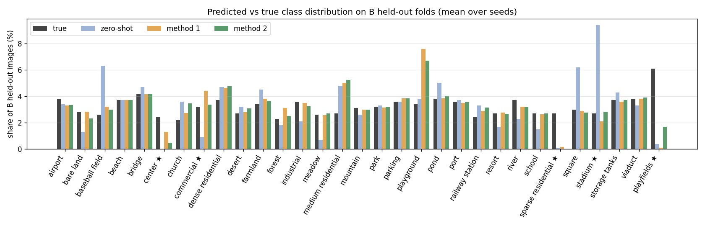

# Diagnosis: why does method 2 gain so little classification accuracy over method 1?

All numbers are on the B held-out folds (`data=kfold5`, every B image predicted once by the model of
the fold it was held out from), methods 1 and 2 with seeds 0, 1, 2 (T = 500, `docs/reproduction.md`).
B class labels are used for evaluation only. No access to A labels/filenames or to C.

Reproduce: the phase-1 runs save `val_logits_fold{k}.pt` (`src/run.py`); then
```
python -m scripts.diagnose_bias --run "supervised=runs/p1/sup_s$s/*/val_logits_fold*.pt" \
    --run "semi=runs/p1/semi_s$s/*/val_logits_fold*.pt" --out runs/diagnosis/s$s        # s = 0, 1, 2
python scripts/diagnosis_report.py --out runs/diagnosis/report.md --plot docs/figs/pred_vs_true.png --logits_root runs/p1
```

## 1. Consistency of `scripts/diagnose_bias.py` with the repository

| item | script | repository | status |
|---|---|---|---|
| fold split | `b_folds` with mode=kfold, k=5, stratify, seed=0 | `configs/data/kfold5.yaml` | identical (unit test compares fold membership) |
| class prompt | "A satellite image of {}.", `class_prompt_names(classes, {})`, mean over templates + L2 norm | `configs/prompts/course.yaml`, `src.evaluate.zero_shot` | identical (unit test) |
| data | `B_labeled.csv`, label column, eval transform via `encode_images` | same loaders | identical |
| stored scores | cosines of L2-normalised adapted features (re-encoded through wrapped `encode_image`) to frozen class embeddings | `run.py` after `evaluate` | argmax reproduces the run's `zs_acc` (83.42 / 82.97 vs 83.43 / 82.97 in `metrics.json`; the per-class mean differs by ≤0.1 because the script pools folds) |
| pseudo-captions | frozen CLIP features, bank = B-train captions of the other folds, R = 0.2 z(S_IT) + 0.8 z(S_II), top-3, τ = 0.1 | `semi.assign_pseudo_captions` | identical scores/weights (unit test, float64); frozen features stand in for the EMA teacher, which at T = 500 is close to frozen CLIP anyway |

Unit tests: `tests/test_diagnose_bias.py` (11 tests: repo consistency, softmax, Sinkhorn row/column
sums for uniform and non-uniform priors, recovery of an injected class bias, hand examples for
the bias / synonym / caption reports, z-score, pseudo-caption cross-check). All 16 repository tests pass.

## 2. Verdict on the pre-registered criteria (TASK.md §4.4, method 2)

| hypothesis | criterion | value (mean over seeds) | verdict |
|---|---|---|---|
| H1 class bias | balancing gain > 2 pts **and** a never/under-predicted class | +0.70 pts (seeds 1.01 / 0.64 / 0.46); 3 under-predicted classes | **not supported** (gain far below 2 pts) |
| H2 conversion | pseudo `caption_right_when_image_wrong` ≥ 30 % **and** `acc_image_x_caption` − acc > 1 pt | 30.70 % (✓, barely); +0.98 pts (seeds 1.19 / 0.73 / 1.01) | **not supported** (second condition missed by 0.02 pts; borderline) |
| H3 near-synonyms | `err_share_into_3_text_nearest` ≥ 2 × chance | 53.1 % vs chance 10 % = 5.3 × | **supported** |

**Method 1 vs method 2 (does caption supervision on A reduce bias?).** Only marginally and not
uniformly: TV(pred, true) 12.22 → 11.52 %, over-predicted classes 1 → 0.33, error share into
over-predicted classes 25 → 8 %; but under-predicted classes 2.3 → 3.0 and never-predicted 0 → 1
(sparse residential). Balancing helps method 2 a little more than method 1 (+0.70 vs +0.03 pts).
Both adapted models are far less biased than zero-shot (TV 23.6 %, balancing +4.5 pts; zero-shot
never predicts center and over-predicts stadium 9.4 % vs 2.7 %, as in the ROSE notes).

## 3. Interpretation

1. **The remaining error is dominated by two near-synonym pairs**, identical for both methods:
   playfields → playground (21–23 % of all errors) and sparse residential → medium residential
   (11–13 %). The top-10 confusion pairs that involve playfields, sparse residential or center
   account for ≈49 % of all errors for both methods (section 6).
   playfields is the largest class in B (67 images, 6.1 %) and is almost never predicted
   (method 1 0 %, method 2 16 % recall); sparse residential has 0 % recall for both methods.
2. **Adaptation already removed most of the zero-shot class bias**; re-balancing the adapted
   predictions recovers < 1 pt. A uniform prior is also not the true B distribution
   (TV 9 %): playfields would need 6.1 %, uniform gives 3.2 %.
3. **Caption evidence is not class evidence for exactly the failing classes.** Mapping a
   caption to a class through class-name text (τ_text = 0.01) gives 0 % recall for playfields and
   16.7 % for sparse residential even with the image's own human captions, and 3.8 % for center;
   pseudo-captions give 0 / 16.7 / 26.9 %. The B captions explain this: of the 335 playfields
   captions, 135 contain "playground" and none contains "playfield(s)"; only 21 of 150
   sparse-residential captions contain "sparse", and 17 of 130 center captions contain "center".
   Where captions do carry extra class information (H2), combining them with the image gives ≈ +1 pt.
4. The caption-derived class prior is far from the true distribution (TV 21 % vs 9 % for uniform).

## 4. Consequences for phase 3 (to be decided by the user)

The pre-registered design (balanced caption→class bridge) targets H1 and H2. On B, H1 is not
supported and H2 is borderline; the supported failure mode (H3) sits in classes where the
caption→class matrix a_jc itself points to the wrong class. Expected effects, before any run:
- the bridge's hard labels for playfields / sparse residential images would mostly be playground /
  medium residential, i.e. they would reinforce the dominant confusions;
- κ > 0 with a uniform prior would push some mass toward under-predicted classes (playfields,
  sparse residential, center), but the total achievable balancing gain measured here is < 1 pt;
- `prior=caption` is expected to be worse than `uniform` (TV 21 % vs 9 %).

The figure below shows predicted vs true class shares (mean over seeds).



## 5. Caveats

- ≈35 B images per class; per-class recalls move by ≈3 pts per image.
- H2 sits on its thresholds (30.70 % vs 30 %, +0.98 vs +1 pt); seeds 0 and 2 alone would pass
  (+1.19, +1.01), seed 1 would not (+0.73). The verdict follows the pre-registered rule on the seed mean.
- Pseudo-captions in the diagnosis use frozen features, not the trained EMA teacher.
- A's class distribution is unknown (labels unseen); the B findings may transfer only partly.

## 6. Full tables (generated by `scripts/diagnosis_report.py`)

Seeds: s0, s1, s2 (zero-shot is deterministic).

### H1 class bias

| metric | zero-shot | method 1 | method 2 |
|---|---|---|---|
| acc (%) | 63.62 ± 0.00 | 82.97 ± 0.31 | 83.42 ± 0.23 |
| mean_per_class_acc (%) | 63.51 ± 0.00 | 84.57 ± 0.36 | 84.57 ± 0.24 |
| tv_pred_vs_true (%) | 23.58 ± 0.00 | 12.22 ± 0.04 | 11.52 ± 0.52 |
| n_never_predicted | 1.00 ± 0.00 | 0.00 ± 0.00 | 1.00 ± 0.00 |
| n_under_predicted(<0.5x) | 6.00 ± 0.00 | 2.33 ± 0.47 | 3.00 ± 0.00 |
| n_over_predicted(>2x) | 3.00 ± 0.00 | 1.00 ± 0.00 | 0.33 ± 0.47 |
| err_share_into_over_predicted (%) | 42.71 ± 0.00 | 25.22 ± 0.33 | 7.61 ± 10.76 |
| acc_after_balancing_uniform (%) | 68.10 ± 0.00 | 83.00 ± 0.59 | 84.13 ± 0.23 |
| mpc_after_balancing_uniform (%) | 68.36 ± 0.00 | 84.45 ± 0.59 | 85.68 ± 0.21 |
| acc_after_balancing_oracle_prior (%) | 67.55 ± 0.00 | 81.75 ± 0.51 | 83.52 ± 0.28 |
| mpc_after_balancing_oracle_prior (%) | 66.46 ± 0.00 | 82.13 ± 0.53 | 83.51 ± 0.32 |

### H2 conversion

| metric | zero-shot | method 1 | method 2 |
|---|---|---|---|
| gt_captions/acc_caption_only (%) | 77.06 ± 0.00 | 77.06 ± 0.00 | 77.06 ± 0.00 |
| gt_captions/caption_right_when_image_wrong (%) | 54.52 ± 0.00 | 35.05 ± 0.92 | 36.40 ± 0.68 |
| gt_captions/acc_image_x_caption (%) | 82.18 ± 0.00 | 84.03 ± 0.16 | 85.04 ± 0.09 |
| pseudo_captions/acc_caption_only (%) | 74.04 ± 0.00 | 74.04 ± 0.00 | 74.04 ± 0.00 |
| pseudo_captions/caption_right_when_image_wrong (%) | 47.74 ± 0.00 | 30.76 ± 0.98 | 30.70 ± 0.20 |
| pseudo_captions/acc_image_x_caption (%) | 78.34 ± 0.00 | 83.70 ± 0.16 | 84.40 ± 0.04 |

### H3 near-synonyms

| metric | zero-shot | method 1 | method 2 |
|---|---|---|---|
| err_share_into_3_text_nearest (%) | 28.14 ± 0.00 | 56.17 ± 1.60 | 53.13 ± 0.27 |
| chance_level (%) | 10.00 ± 0.00 | 10.00 ± 0.00 | 10.00 ± 0.00 |
| spearman(text_sim, confusion) | 0.33 ± 0.00 | 0.30 ± 0.01 | 0.28 ± 0.01 |

Class prior: TV(uniform, true) = 8.95 %, TV(caption prior, true) = 21.08 %.

### Pre-registered criteria (method 2, mean over seeds; per-seed in brackets)

| hypothesis | criterion | value | supported |
|---|---|---|---|
| H1 bias | acc_after_balancing_uniform − acc > 2 pts | 0.70 [1.01, 0.64, 0.46] pts | no |
| | and ≥1 class never / under-predicted (<0.5× true share) | 3.00 [3.00, 3.00, 3.00] classes | |
| H2 conversion | pseudo caption_right_when_image_wrong ≥ 30 % | 30.70 [30.43, 30.90, 30.77] % | no |
| | and acc_image_x_caption − acc > 1 pt | 0.98 [1.19, 0.73, 1.01] pts | |
| H3 near-synonyms | err_share_into_3_text_nearest ≥ 2 × chance | 5.31 [5.33, 5.34, 5.27] × chance | yes |

### Per-class (mean over seeds, %; ★ = classes named in TASK.md)

| class | n | true share | ZS pred share | ZS recall | M1 pred share | M1 recall | M2 pred share | M2 recall | GT-caption recall | pseudo-caption recall |
|---|---|---|---|---|---|---|---|---|---|---|
| airport | 42 | 3.8 | 3.4 | 81.0 | 3.3 ± 0.1 | 83.3 ± 3.3 | 3.3 ± 0.0 | 84.1 ± 1.1 | 100.0 | 95.2 |
| bare land | 31 | 2.8 | 1.3 | 16.1 | 2.8 ± 0.1 | 86.0 ± 4.0 | 2.3 ± 0.0 | 75.3 ± 1.5 | 93.5 | 90.3 |
| baseball field | 28 | 2.6 | 6.3 | 100.0 | 3.2 ± 0.1 | 96.4 ± 0.0 | 3.0 ± 0.1 | 100.0 ± 0.0 | 96.4 | 100.0 |
| beach | 40 | 3.7 | 3.7 | 97.5 | 3.7 ± 0.0 | 100.0 ± 0.0 | 3.7 ± 0.0 | 100.0 ± 0.0 | 100.0 | 95.0 |
| bridge | 46 | 4.2 | 4.7 | 97.8 | 4.2 ± 0.0 | 97.8 ± 0.0 | 4.2 ± 0.0 | 95.7 ± 0.0 | 93.5 | 95.7 |
| center ★ | 26 | 2.4 | 0.0 | 0.0 | 1.3 ± 0.2 | 41.0 ± 1.8 | 0.5 ± 0.0 | 17.9 ± 1.8 | 3.8 | 26.9 |
| church | 24 | 2.2 | 3.6 | 62.5 | 2.7 ± 0.0 | 91.7 ± 0.0 | 3.5 ± 0.0 | 97.2 ± 2.0 | 100.0 | 54.2 |
| commercial ★ | 35 | 3.2 | 0.9 | 5.7 | 4.4 ± 0.2 | 94.3 ± 0.0 | 3.4 ± 0.2 | 84.8 ± 1.3 | 22.9 | 20.0 |
| dense residential | 41 | 3.7 | 4.7 | 97.6 | 4.6 ± 0.0 | 100.0 ± 0.0 | 4.8 ± 0.1 | 100.0 ± 0.0 | 95.1 | 100.0 |
| desert | 30 | 2.7 | 3.2 | 90.0 | 2.8 ± 0.1 | 91.1 ± 1.6 | 3.1 ± 0.0 | 96.7 ± 0.0 | 100.0 | 100.0 |
| farmland | 37 | 3.4 | 4.5 | 97.3 | 3.8 ± 0.1 | 100.0 ± 0.0 | 3.7 ± 0.0 | 100.0 ± 0.0 | 97.3 | 97.3 |
| forest | 25 | 2.3 | 1.8 | 68.0 | 3.1 ± 0.1 | 100.0 ± 0.0 | 2.5 ± 0.0 | 100.0 ± 0.0 | 100.0 | 100.0 |
| industrial | 39 | 3.6 | 2.1 | 43.6 | 3.5 ± 0.0 | 87.2 ± 0.0 | 3.2 ± 0.0 | 84.6 ± 0.0 | 97.4 | 89.7 |
| meadow | 28 | 2.6 | 0.7 | 28.6 | 2.6 ± 0.1 | 88.1 ± 3.4 | 2.7 ± 0.0 | 96.4 ± 0.0 | 28.6 | 32.1 |
| medium residential | 29 | 2.7 | 4.8 | 96.6 | 5.0 ± 0.2 | 94.3 ± 1.6 | 5.2 ± 0.0 | 97.7 ± 1.6 | 10.3 | 34.5 |
| mountain | 34 | 3.1 | 2.6 | 82.4 | 3.0 ± 0.0 | 97.1 ± 0.0 | 3.0 ± 0.0 | 97.1 ± 0.0 | 100.0 | 97.1 |
| park | 35 | 3.2 | 3.3 | 68.6 | 3.1 ± 0.1 | 75.2 ± 1.3 | 3.2 ± 0.2 | 80.0 ± 2.4 | 48.6 | 42.9 |
| parking | 39 | 3.6 | 3.6 | 100.0 | 3.8 ± 0.1 | 100.0 ± 0.0 | 3.8 ± 0.0 | 100.0 ± 0.0 | 100.0 | 100.0 |
| playground | 37 | 3.4 | 3.8 | 8.1 | 7.6 ± 0.1 | 96.4 ± 1.3 | 6.7 ± 0.2 | 88.3 ± 3.4 | 91.9 | 67.6 |
| pond | 42 | 3.8 | 5.0 | 97.6 | 3.8 ± 0.0 | 91.3 ± 1.1 | 4.0 ± 0.0 | 95.2 ± 0.0 | 97.6 | 100.0 |
| port | 39 | 3.6 | 3.7 | 97.4 | 3.5 ± 0.0 | 97.4 ± 0.0 | 3.6 ± 0.0 | 97.4 ± 0.0 | 97.4 | 92.3 |
| railway station | 26 | 2.4 | 3.3 | 92.3 | 2.9 ± 0.1 | 100.0 ± 0.0 | 3.1 ± 0.0 | 100.0 ± 0.0 | 100.0 | 92.3 |
| resort | 29 | 2.7 | 1.7 | 48.3 | 2.8 ± 0.2 | 82.8 ± 2.8 | 2.7 ± 0.0 | 85.1 ± 1.6 | 89.7 | 100.0 |
| river | 41 | 3.7 | 2.3 | 58.5 | 3.2 ± 0.1 | 83.7 ± 1.2 | 3.2 ± 0.0 | 82.1 ± 1.1 | 100.0 | 100.0 |
| school | 30 | 2.7 | 1.5 | 13.3 | 2.6 ± 0.1 | 88.9 ± 4.2 | 2.7 ± 0.0 | 86.7 ± 0.0 | 86.7 | 66.7 |
| sparse residential ★ | 30 | 2.7 | 0.1 | 0.0 | 0.2 ± 0.0 | 0.0 ± 0.0 | 0.0 ± 0.0 | 0.0 ± 0.0 | 16.7 | 16.7 |
| square | 33 | 3.0 | 6.2 | 39.4 | 2.9 ± 0.1 | 80.8 ± 3.7 | 2.8 ± 0.0 | 73.8 ± 2.9 | 63.6 | 42.4 |
| stadium ★ | 29 | 2.7 | 9.4 | 100.0 | 2.1 ± 0.0 | 79.3 ± 0.0 | 2.8 ± 0.0 | 89.7 ± 0.0 | 86.2 | 100.0 |
| storage tanks | 40 | 3.7 | 4.3 | 95.0 | 3.6 ± 0.0 | 97.5 ± 0.0 | 3.7 ± 0.0 | 100.0 ± 0.0 | 92.5 | 100.0 |
| viaduct | 42 | 3.8 | 3.3 | 85.7 | 3.8 ± 0.0 | 100.0 ± 0.0 | 3.9 ± 0.0 | 100.0 ± 0.0 | 95.2 | 64.3 |
| playfields ★ | 67 | 6.1 | 0.4 | 0.0 | 0.1 ± 0.0 | 0.0 ± 0.0 | 1.7 ± 0.2 | 15.9 ± 1.4 | 0.0 | 0.0 |

### Most frequent confusions (true → predicted; images per seed, mean over seeds; share of all errors)

**method 1** (186.3 errors per seed)

| true → predicted | images | share of errors (%) |
|---|---|---|
| playfields → playground | 43.0 | 23.1 |
| sparse residential → medium residential | 20.0 | 10.7 |
| playfields → baseball field | 8.0 | 4.3 |
| playfields → medium residential | 7.0 | 3.8 |
| airport → railway station | 5.0 | 2.7 |
| center → commercial | 5.0 | 2.7 |
| center → church | 4.7 | 2.5 |
| center → square | 3.7 | 2.0 |
| bare land → desert | 3.3 | 1.8 |
| stadium → playground | 3.3 | 1.8 |

**method 2** (181.3 errors per seed)

| true → predicted | images | share of errors (%) |
|---|---|---|
| playfields → playground | 38.3 | 21.1 |
| sparse residential → medium residential | 23.0 | 12.7 |
| center → church | 7.3 | 4.0 |
| center → square | 6.0 | 3.3 |
| playfields → medium residential | 6.0 | 3.3 |
| airport → railway station | 5.0 | 2.8 |
| industrial → dense residential | 5.0 | 2.8 |
| playfields → baseball field | 4.3 | 2.4 |
| center → stadium | 4.0 | 2.2 |
| bare land → desert | 3.7 | 2.0 |

